# OAPW Player HiFi (192kHz / 32-Bit)

Audiophiler Audio-Stream-Player für den Raspberry Pi 5 unter Debian Trixie (Debian 12). Dieses System implementiert ein hochpräzises **Ambiophonics RACE DSP** (akustische Übersprechdämpfung) sowie einen parametrischen Equalizer für kompromisslose Musikwiedergabe über High-End I2S DACs (z. B. Allo Katana DAC, Boss DAC) sowie universelle USB-DACs.

---

## 💎 Hauptmerkmale (HiFi-Version)

- **Lock-Freie Architektur:** Vollständige Eliminierung von `std::lock_guard` aus dem zeitkritischen Audio-Thread. Das Web-GUI liest und schreibt Parameter über atomare Zustände, wodurch Buffer Underruns (Xruns) durch Thread-Blockaden physikalisch unmöglich sind.
- **NEON SIMD Parallelisierung:** Die mathematischen Kernkomponenten (Biquads, FFT) wurden von 64-Bit `double` auf 32-Bit `float` umgestellt. Dies erlaubt dem Cortex-A76 des RPi 5 eine hocheffiziente Vektorisierung (Verarbeitung von 4 Operationen zeitgleich pro Taktzyklus).
- **Dynamische Linkwitz-Riley-Filter (4. Ordnung):** Anstelle statischer, fehleranfälliger IIR-Polynome berechnet die Engine die Frequenzweichen für das RACE-Crosstalk-Signal nun zur Laufzeit dynamisch. Dies garantiert selbst bei extremen 192 kHz eine absolut phasenstarre, räumlich transparente Bühnenabbildung ohne numerische Instabilität.
- **Bitperfekter ALSA-Sync:** Die Software-Blockgröße ist starr an die ALSA Hardware-Periodengröße von exakt **1024 Frames** gekoppelt.
- **POSIX Echtzeit-Scheduling:** Der Audio-Thread läuft mit höchster Linux-Priorität (`SCHED_FIFO` Prio 85) und ist immun gegen Betriebssystem-Hintergrundprozesse.
- **Rückwirkungsfreies Web-Interface:** HTML5/JavaScript-Oberfläche inklusive hochauflösendem Live-Spektrumanalyzer auf Port `8080`.

---

## 🏗️ Universelle Endausbau-Architektur

Das System nutzt eine integrierte **MPD + FFmpeg-Pipeline**. MPD (Music Player Daemon) dient als puristische High-Res-Streaming-Quelle (z. B. für lokale FLAC/WAV-Dateien oder Qobuz-Master-Streams). Da MPD beim nativen Schreiben in Named Pipes (`fifo`) jedoch standardmäßig 32-Bit-Floats ausgibt (was ohne strikte Protokollführung zu Byte-Verschiebungen und bösartigem digitalen Brummen/Kratzen im DSP führt), wird **FFmpeg direkt als On-the-fly-Konverter** in MPD eingebettet.

FFmpeg fängt den Stream ab, führt das mathematisch präzise Upsampling durch und skaliert das Signal per **Bit-Padding hocheffizient auf den vollen 32-Bit-Signed-Integer-Wertebereich (`s32le`)** hoch. Dadurch liegt das Signal im C++ DSP immer im perfekten Arbeitsbereich von `-1.0` bis `+1.0`.

```mermaid
graph TD
    %% Datenquellen & Input
    subgraph Stream_Quelle [Audiophile Quelle]
        A[MPD: Lokale Musik / Qobuz Stream] -->|s16le / Nativ| B(Integrierte FFmpeg-Schnittstelle)
        B -->|Soxr-Upsampling & s32le Bit-Padding| C(Linux Named Pipe: /tmp/oapw_stream)
    end

    %% Echtzeit-Audio-Verarbeitung
    subgraph Echtzeit_Audio_Thread [Echtzeit Audio-Thread: SCHED_FIFO Prio 85]
        C -->|Blockierendes Lesen: 1024 Frames int32_t| D[Audio Loop in main.cpp]
        D -->|Division durch 2147483648.0| E[RACEDspEngine::processFramesForAlsa]
        
        %% DSP Details
        E --> F{RACE Aktiv?}
        F -->|Ja| G[4th Order Linkwitz-Riley HP/LP Filter]
        G --> H[Delay-Buffer & Dämpfung / Crosstalk]
        F -->|Nein / Bypass| I[Bypass Pegel-Berechnung]
        
        H --> J[Parametrischer EQ: 3x Biquad pro Kanal]
        I --> J
        J --> K[Hard-Clipping Schutz: std::clamp]
        
        %% Output & Hardware
        K -->|Format-Konvertierung: Float zu Int32| L[ALSA Puffer: S32_LE]
        L -->|snd_pcm_writei| M{Geräte-Modus?}
        
        %% DAC Varianten
        M -->|hw:0,0| N[High-End I2S DACs: Katana / Boss 192kHz nativ]
        M -->|plughw:0,0| O[USB DACs: Sharkoon etc. Auto-Downsampling]
    end

    %% Web-Interface & Steuerung
    subgraph Asynchroner_GUI_Thread [Asynchroner Webserver-Thread: Port 8080]
        P[Browser / Web-Interface] -->|HTTP GET /api/update| Q[API Parameter Update]
        Q -->|Lock-freie atomare Zuweisung| J
        Q -->|Lock-freie atomare Zuweisung| H
        
        K -.->|Lock-freies Schreiben| R[(spectrumBuffer)]
        R -.->|8192-Sample Kopie ohne Mutex| S[computeFFT: float-basiert]
        S -->|Logarithmische Skalierung| T[HTTP GET /api/spectrum]
        T -.->|JSON Daten| P
    end

    %% Styling
    style Echtzeit_Audio_Thread fill:#1a1010,stroke:#ff3b30,stroke-width:2px;
    style Asynchroner_GUI_Thread fill:#101520,stroke:#007aff,stroke-width:2px;
```



---

## 🔌 Hardware-Kompatibilität & DAC-Szenarien

Das System arbeitet mit einem **Festtakt-Konzept (Master-Clock-Prinzip)**. Der DAC sieht permanent einen konstanten 192-kHz-Stream, was unschönes Hardware-Umschaltknacken bei Songwechseln (z. B. von 44.1 kHz auf 96 kHz) physikalisch eliminiert. Das Verhalten skaliert je nach angeschlossenem DAC wie folgt:

1. **High-End I2S DACs (Allo Katana, Allo Boss):** Unterstützen 192 kHz / 32-Bit nativ über den I2S-Bus des RPi 5. Der Betrieb erfolgt kompromisslos bitperfekt im direkten Hardware-Modus (`--device hw:0,0`).
2. **Standard USB-DACs (z. B. Sharkoon Gaming DAC Pro S v2):** Diese DACs riegeln hardwareseitig oft bei 96 kHz / 24-Bit ab. Um das System universell zu betreiben, wird das ALSA-Plug-Interface genutzt (`--device plughw:0,0`). Das C++ Programm rechnet intern weiterhin hochpräzise mit 192 kHz, während ALSA im allerletzten Schritt vor der USB-Buchse ein jitterarmes, stabiles Downsampling vornimmt.

---

## 🛠️ Kompilieren auf dem Raspberry Pi 5

Stellen Sie sicher, dass die ALSA-Entwicklungspakete auf Ihrem System installiert sind:
```bash
sudo apt update
sudo apt install libasound2-dev cmake g++
```

Erstellen Sie ein Build-Verzeichnis und kompilieren Sie das Projekt:
```bash
mkdir -p build && cd build
cmake ..
make -j$(nproc)
```

---

## 🚀 Nutzung und Konfiguration

### 1. MPD einrichten (`/etc/mpd.conf`)
Um das integrierte FFmpeg-Upsampling als Live-Konverter in MPD einzubetten, nutzen wir das `pipe`-Plugin von MPD. Öffnen Sie die `/etc/mpd.conf` und konfigurieren Sie den Ausgang wie folgt:

```text
audio_output {
    type        "pipe"
    name        "OAPW Integrated FFmpeg"
    # Zwingt MPD zum 192kHz Upsampling und sauberer Float-Ausgabe
    format      "192000:f:2"
    # FFmpeg liest die Floats (f32le) und wandelt sie bitperfekt in Integer (s32le) um
    command     "ffmpeg -v quiet -f f32le -ar 192000 -ac 2 -i - -f s32le -ac 2 pipe:1 > /tmp/oapw_stream"
}
```
MPD benötigt Zugriff auf das /tmp-Verzeichnis für die Pipe (/tmp/oapw_stream) und Lesezugriff auf die Musikdateien.

```text
sudo mkdir -p /etc/systemd/system/mpd.service.d
echo -e "[Service]\nProtectHome=read-only\nPrivateTmp=false" | sudo tee /etc/systemd/system/mpd.service.d/override.conf
sudo systemctl daemon-reload
```

Danach den Dienst neu starten: `sudo systemctl restart mpd`...

... und die Pipe zur Sicherheit neu anlegen und mit den korrekten Rechten ausstatten:

```text
sudo rm -f /tmp/oapw_stream
mkfifo /tmp/oapw_stream
sudo chmod 666 /tmp/oapw_stream
```

### 2. Player via Shell starten

**Für High-End I2S DACs (Nativ-Modus) sudo ermöglicht dabei die Priorisierung des OAPW_Players auf der CPU:**
```bash
sudo ./OAPW_Player_HiFi --device hw:0,0 --stream /tmp/oapw_stream
```

**Für USB-DACs oder Fallback (Kompatibilitäts-Modus):**
```bash
sudo ./OAPW_Player_HiFi --device plughw:0,0 --stream /tmp/oapw_stream
```

### 3. Musik abspielen (`mpc`)
Aktualisieren Sie die MPD-Datenbank und steuern Sie die Wiedergabe relativ zu Ihrem Musik-Ordner:
```bash
mpc update
mpc clear
mpc add "Dein_Ordner/Dein_Album"
mpc play
```

---

## 🌐 Das Web-Interface nutzen

Rufen Sie im selben Netzwerk die Seite des Pi auf: `http://<IP-ADRESSE-DEINES-PI>:8080`.
*Nutzen Sie nach dem ersten Start unbedingt einen harten Browser-Reset (`Strg+F5` oder `Cmd+Shift+R`), um das bereinigte JavaScript zu laden.*

- **A/B-Vergleich:** Verzögerungsfreies Umschalten von `RACE: AN` auf `RACE: AUS`.
- **Geometrie-Rechner:** Berechnet live das ideale Interaural Delay (μ s) und die Dämpfung (dB).
- **Hochauflösender Real-Time Analyzer:** Logarithmisch skalierter 32-Balken-Frequenzvisualisierer von 20 Hz bis 20 kHz. Durch ein massiv vergrößertes FFT-Zeitfenster von 8192 Samples werden selbst bei 192 kHz tiefste Bassfrequenzen recht präzise aufgelöst und (fast komplett) getrennt dargestellt.
