# OAPW Player HiFi (192kHz / 32-Bit)

Audiophiler Audio-Stream-Player für den Raspberry Pi 5 unter Debian Trixie (Debian 12). Dieses System implementiert ein hochpräzises **Ambiophonics RACE DSP** (akustische Übersprechdämpfung) sowie einen parametrischen Equalizer für kompromisslose Musikwiedergabe über High-End I2S DACs (z. B. Allo Katana DAC, Boss DAC).

---

## 💎 Hauptmerkmale (HiFi-Version)

- **Lock-Freie Architektur:** Vollständige Eliminierung von `std::lock_guard` aus dem zeitkritischen Audio-Thread. Das Web-GUI liest und schreibt Parameter über atomare Zustände, wodurch Buffer Underruns (Xruns) durch Thread-Blockaden physikalisch unmöglich sind.
- **NEON SIMD Parallelisierung:** Die mathematischen Kernkomponenten (Biquads, FFT) wurden von 64-Bit `double` auf 32-Bit `float` umgestellt. Dies erlaubt dem Cortex-A76 des RPi 5 eine hocheffiziente Vektorisierung (Verarbeitung von 4 Operationen zeitgleich pro Taktzyklus).
- **Stabile Kaskaden-Filter:** Die instabilen IIR-Filter hoher Ordnung wurden durch kaskadierte Biquad-Filter (2x 2nd Order = 4th Order Linkwitz-Riley/Butterworth) ersetzt. Dies garantiert absolute Stabilität gegen Koeffizienten-Rauschen bei 192 kHz.
- **Bitperfekter ALSA-Sync:** Die Software-Blockgröße ist starr an die ALSA Hardware-Periodengröße von exakt **1024 Frames** gekoppelt.
- **POSIX Echtzeit-Scheduling:** Der Audio-Thread läuft mit höchster Linux-Priorität (`SCHED_FIFO` Prio 85) und ist immun gegen Betriebssystem-Hintergrundprozesse.
- **Rückwirkungsfreies Web-Interface:** HTML5/JavaScript-Oberfläche inklusive Live-Spektrumananalyzer auf Port `8080`.

---

## 🏗️ Signal- und Verarbeitungsfluss (DSP Engine)

Das folgende Diagramm zeigt den Daten- und Steuerfluss. Die rote Trennlinie verdeutlicht die strikte Trennung zwischen dem Echtzeit-Audio-Thread und dem asynchronen Netzwerk-Thread:

```mermaid
graph TD
    %% Datenquellen & Input
    subgraph Input_Schnittstelle [Eingangs-Schnittstelle]
        A[Musikquelle: z.B. FFmpeg / MPD] -->|32-Bit PCM s32le| B(Linux Named Pipe: /tmp/oapw_stream)
        B -->|Blockierendes Lesen: 1024 Frames| C[Audio Loop in main.cpp]
    end

    %% Echtzeit-Audio-Verarbeitung
    subgraph Echtzeit_Audio_Thread [Echtzeit Audio-Thread: SCHED_FIFO Prio 85]
        C -->|Cast zu float: -1.0 bis 1.0| D[RACEDspEngine::processFramesForAlsa]
        
        %% DSP Details
        D --> E{RACE Aktiv?}
        E -->|Ja| F[4th Order Biquad HP/LP Filter]
        F --> G[Delay-Buffer & Dämpfung / Crosstalk]
        E -->|Nein / Bypass| H[Bypass Pegel-Berechnung]
        
        G --> I[Parametrischer EQ: 3x Biquad pro Kanal]
        H --> I
        I --> J[Hard-Clipping Schutz: std::clamp]
        
        %% Output & Hardware
        J -->|Format-Konvertierung: Float zu Int32| K[ALSA Puffer: S32_LE]
        K -->|snd_pcm_writei: Blockierendes Schreiben| L[Hardware DAC: Katana / Boss]
    end

    %% Web-Interface & Steuerung
    subgraph Asynchroner_GUI_Thread [Asynchroner Webserver-Thread: Port 8080]
        M[Browser / Web-Interface] -->|HTTP GET /api/update| N[API Parameter Update]
        N -->|Lock-freie atomare Zuweisung| I
        N -->|Lock-freie atomare Zuweisung| G
        
        J -.->|Lock-freies Schreiben| O[(spectrumBuffer)]
        O -.->|Kopie ohne Mutex| P[computeFFT: float-basiert]
        P -->|Logarithmische Skalierung| Q[HTTP GET /api/spectrum]
        Q -.->|JSON Daten| M
    end

    %% Styling
    style Echtzeit_Audio_Thread fill:#1a1010,stroke:#ff3b30,stroke-width:2px;
    style Asynchroner_GUI_Thread fill:#101520,stroke:#007aff,stroke-width:2px;
```



---

## 🛠️ Kompilieren auf dem Raspberry Pi 5

Stellen Sie sicher, dass die ALSA-Entwicklungspakete auf Ihrem System installiert sind:
```bash
sudo apt update
sudo apt install libasound2-dev cmake g++
```

Erstellen Sie ein Build-Verzeichnis und kompilieren Sie das Projekt mit den optimierten Cortex-A76-Flags (automatisch über `CMakeLists.txt` definiert):
```bash
mkdir -p build && cd build
cmake ..
make -j$(nproc)
```
Das fertige Binary heißt **`OAPW_Player_HiFi`**.

---

## 🚀 Nutzung über die Shell (Kommandozeile)

### 1. ALSA-Geräte-ID ermitteln
Prüfen Sie, unter welcher Kartennummer sich Ihr DAC HAT registriert hat:
```bash
aplay -l
```
Für den Allo Katana DAC lautet die Standardadresse meistens **`hw:0,0`**.

### 2. High-End-Streaming via FFmpeg (Empfohlen für 192kHz Bitperfektion)
Um gewöhnliche Musikdateien (z. B. 44.1 kHz CDs) audiophil und jitterfrei abzuspielen, schalten wir FFmpeg vor den Player. FFmpeg übernimmt das präzise Upsampling über den High-Quality `soxr`-Resampler und liefert das perfekte 32-Bit-Integer-Format an die Linux-Pipe.

**Schritt A: Player im Stream-Modus starten (Wartet auf Daten)**
Da das Programm Echtzeit-Rechte anfordert, muss es mit `sudo` gestartet werden:
```bash
sudo ./OAPW_Player_HiFi --device hw:0,0 --stream /tmp/oapw_stream
```

**Schritt B: FFmpeg in einem zweiten Terminal starten (Füttert die Kette)**
```bash
ffmpeg -i "/pfad/zu/deiner/musikdatei.mp3" \
  -af "aresample=resampler=soxr:osr=192000:dither_method=triangular" \
  -f s32le -ac 2 -y /tmp/oapw_stream
```
*(Funktioniert identisch mit `.wav`, `.flac` oder Netzwerk-Streams).*

### 3. Direkter Datei-Modus (Native 192kHz Dateien)
Wenn Sie bereits eine native 192kHz/24-Bit oder 32-Bit WAV-Datei vorliegen haben, können Sie diese auch direkt ohne FFmpeg abspielen:
```bash
sudo ./OAPW_Player_HiFi --device hw:0,0 --file "/pfad/zu/high_res_datei.wav"
```

---

## 🌐 Das Web-Interface nutzen

Sobald der Player aktiv ist, öffnet er den Port `8080`. Rufen Sie an einem beliebigen Gerät im selben Netzwerk die Seite auf:
```text
http://<IP-ADRESSE-DEINES-PI>:8080
```

### Features im Webserver:
- **A/B-Vergleich:** Sofortiges, unterbrechungsfreies Umschalten von `RACE: AN` auf `RACE: AUS`.
- **Geometrie-Rechner:** Geben Sie den Abstand Ihrer Lautsprecher und Ihre Hördistanz ein. Die App errechnet automatisch das perfekte Interaural Delay in Mikrosekunden (\(\mu s\)) sowie die akustische Dämpfung (\(dB\)) und wendet diese live an.
- **Parametrischer EQ:** Dreistufige Live-Frequenzkorrektur für Bass, Mitten und Höhen.
- **Real-Time Analyzer:** Logarithmisch skalierter 64-Balken-Frequenzvisualisierer von 20 Hz bis 22 kHz.
